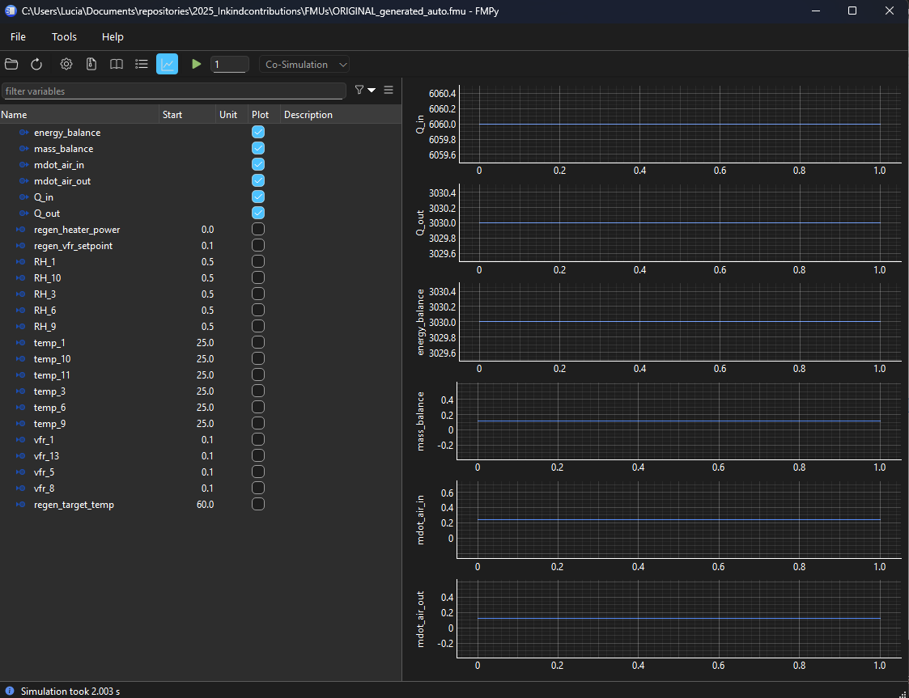

# Getting started

How to install fmugen, turn a model into an FMU, and simulate it.

- [How it works](#how-it-works)
- [Installation](#installation)
- [From model to FMU](#from-model-to-fmu)
- [Simulating the FMU](#simulating-the-fmu)
- [Where to go next](#where-to-go-next)

---

## How it works

`fmugen` turns an unmodified Python model into a [UniFMU](https://github.com/INTO-CPS-Association/unifmu) FMU: FMI 2.0 or FMI 3.0, Co-Simulation.

- **The model** is any importable function or class: your own file or an installed package. fmugen never edits it.
- **`fmugen.toml`** says how the model maps onto FMU variables: which arguments are inputs or parameters, where outputs come from, units, the experiment, and so on.
- **`fmugen init`** writes a first `fmugen.toml` by inspecting the model.
- **`fmugen build`** packages the model and its config into an `.fmu`.

```
your model ──► fmugen init ──► fmugen.toml ──► (review & edit) ──► fmugen build ──► model.fmu
```

---

## Installation

Install fmugen into the virtual environment of your model, the one that already has the model's packages. fmugen is not on PyPI yet, so install it from a clone of this repository:

```bash
pip install path/to/2025_Inkindcontributions
```

(or `uv add path/to/2025_Inkindcontributions`). This also installs `protobuf==5.27.3`, `pyzmq` and `cloudpickle`, which UniFMU's Python backend needs to run the FMU. Run `fmugen` from that environment: `init` and `build` import your model, and by default the FMU runs with that environment's Python ([details](packaging.md#the-fmus-python-environment)).

`fmugen build` also needs [UniFMU](https://github.com/INTO-CPS-Association/unifmu/releases) **0.14.0**, exactly this version: fmugen runs `unifmu generate` to create each FMU's native binaries and Python backend. Put the `unifmu` executable on `PATH`, or set `FMUGEN_UNIFMU` to its path. `fmugen init` works without it.

To validate and simulate FMUs as below, install [FMPy](https://github.com/CATIA-Systems/FMPy) too (`pip install fmpy`).

Optional extras:

| Extra | For |
|---|---|
| `[pyinstaller]`, `[nuitka]` | `fmugen build --compile` |
| `[distributed]` | running the private side of a `--distributed` FMU |

e.g. `pip install "path/to/2025_Inkindcontributions[pyinstaller]"`.

---

## From model to FMU

1. Let fmugen inspect the model and write `fmugen.toml` next to it:

   ```bash
   fmugen init path/to/model.py
   ```

   `init` reads your code and never calls the model, so it's safe for models that drive hardware. For ML models, compiled code or array results, add `--probe`: `init` then calls the model once to find array sizes and exact types.

2. Review the file. Check the start values, add units, and remove anything you don't want in the FMU. Commented lines mark what the code didn't show. [init.md](init.md) walks through a generated config.

3. Build:

   ```bash
   fmugen build path/to/fmugen.toml -o out/model.fmu
   ```

4. Check the FMU:

   ```bash
   fmpy validate out/model.fmu
   ```

   ```bash
   fmpy simulate out/model.fmu --output-file out/result.csv
   ```

For a quick try, `fmugen build path/to/model.py -o out/model.fmu` skips step 2: the config is inferred in memory, without units.

### Example: a published PID controller

Install [simple-pid](https://pypi.org/project/simple-pid/) next to fmugen:

```bash
pip install simple-pid
```

See what `init` infers for its `PID` class, printed to the terminal instead of written to a file:

```bash
fmugen init simple_pid:PID -o -
```

It finds `Kp`, `Ki`, `Kd` and `setpoint` as parameters, `input_` as an input, the control output as `y`, and binds `dt` to the step size. Write it to a file (missing folders are created), set `setpoint = { start = 1.0 }`, then build and simulate:

```bash
fmugen init simple_pid:PID -o pid/fmugen.toml
```

```bash
fmugen build pid -o out/pid.fmu
```

```bash
fmpy simulate out/pid.fmu --stop-time 5 --output-file out/pid.csv
```

The FMU built this way runs on this machine. For FMUs that run elsewhere (`--vendor`, `--compile`, `--distributed`), see [packaging.md](packaging.md#fmus-for-other-machines).

---

## Simulating the FMU

Any FMI importer can run the FMU. With FMPy:

```bash
fmpy simulate out/pid.fmu --stop-time 10 --start-values Kp 4 --output-file out/results.csv
```

Time-varying inputs come from a CSV whose first column is time and whose other columns are named like the FMU's inputs, e.g. a `measurements.csv` for the PID FMU:

```
time,input_
0,0.0
5,0.5
```

```bash
fmpy simulate out/pid.fmu --input-file measurements.csv --stop-time 10 --output-file out/pid.csv
```

Without `--output-file`, FMPy plots the result instead, which requires matplotlib. FMPy also has a GUI (`python -m fmpy.gui`): open the `.fmu`, set start values, press play, and tick outputs to plot.



Things to know about FMPy:

- **It shows no reason for a failure**, only the failed FMI call. The model's traceback shows with `simulate_fmu(…, debug_logging=True, logger=print)`.
- **It doesn't free the FMU after an error**, so the FMU's Python process keeps running ([workaround](limitations/fmpy.md#1-simulate_fmu-doesnt-free-the-instance-after-an-fmu-error)).
- **It never ticks FMI 3 input clocks.** `simulate_fmu(..., event_mode_used=True)` handles output clocks and `[events] terminate`; FMUs whose code runs on input clocks need an importer that ticks them, or a script using `fmpy.fmi3.FMU3Slave` (see `tests/test_fmi3.py`).
- **String outputs aren't in its result** ([details](limitations/fmpy.md#2-the-result-array-has-no-strings)).

---

## Where to go next

| To… | Read |
|---|---|
| Look up an option of `fmugen init` or `fmugen build` | [cli.md](cli.md) |
| Understand and edit the config `init` wrote | [init.md](init.md) |
| See how a kind of model (class, arrays, clocks, setup calls…) is configured | [models.md](models.md) |
| Look up a `fmugen.toml` key | [config.md](config.md) |
| Fix an error | [troubleshooting.md](troubleshooting.md) |
